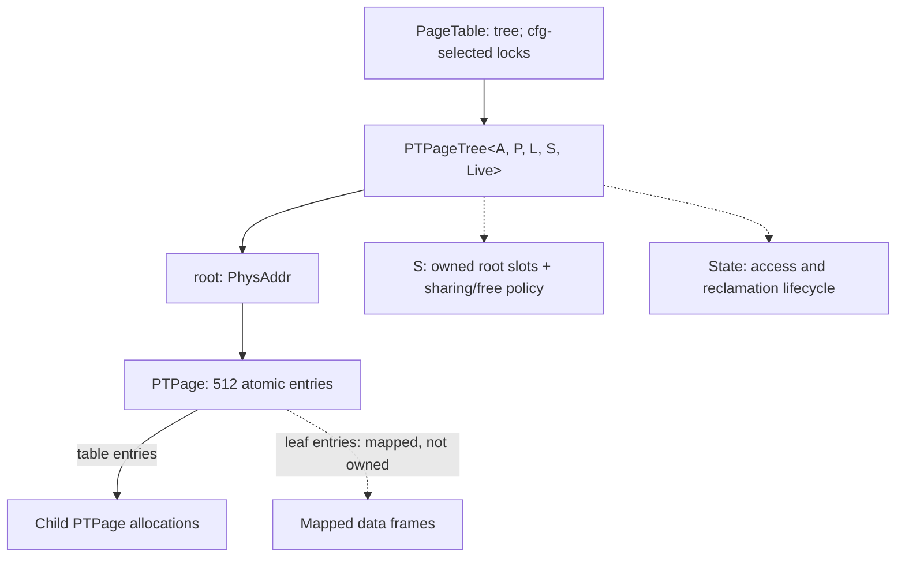
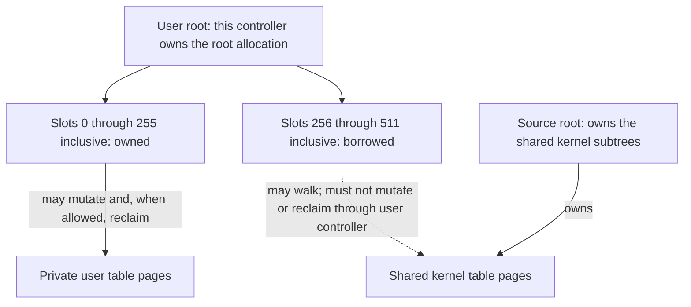
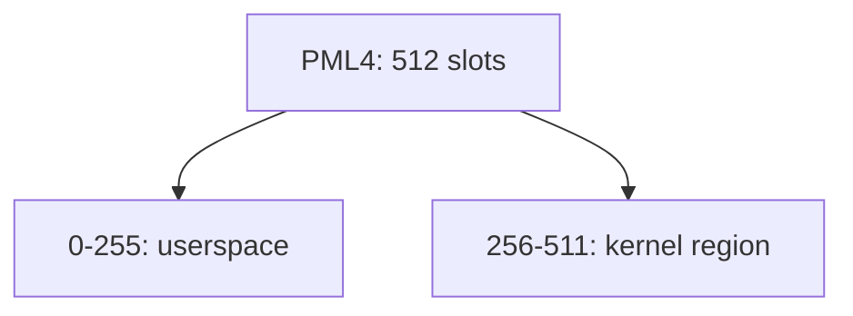
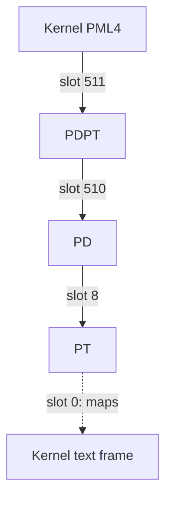
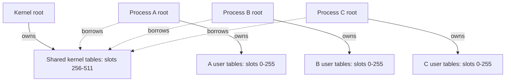
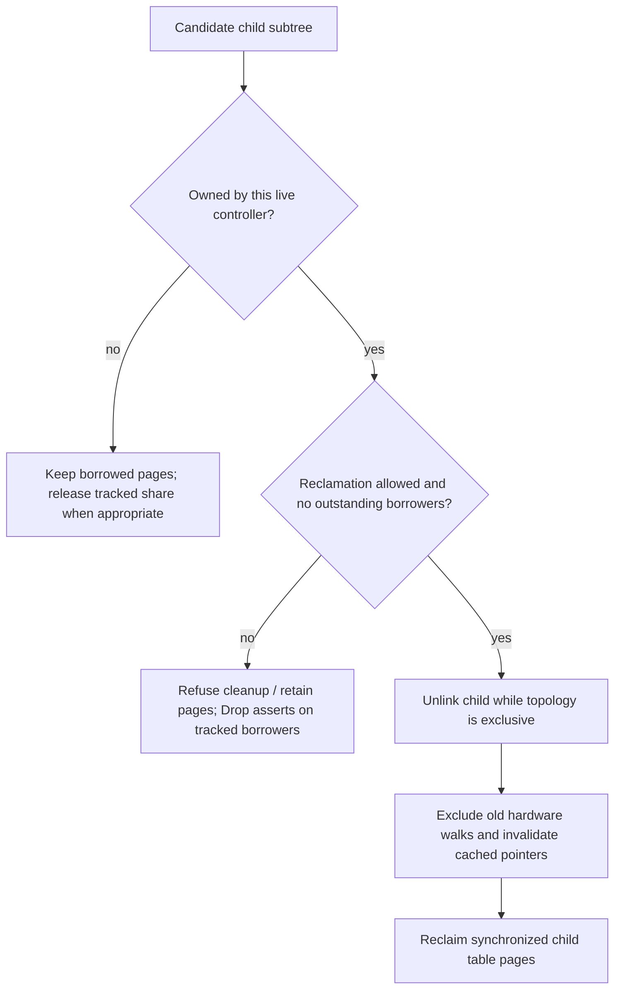

# Page-table tree: storage, lifecycle, and ownership

`PTPageTree` is the resource owner behind a `PageTable` controller. It owns
page-table allocations, not the data frames described by leaf entries. Its
design separates two questions:

- **Lifecycle state:** how may this tree be accessed, and has hardware stopped
  using pages that might be reclaimed?
- **Ownership policy:** which root entries belong to this controller, and which
  are borrowed from another tree?

Neither answer implies the other. An owned subtree may still be visible to
hardware; a synchronized tree may still contain borrowed subtrees.

## Representation and type parameters

The declaration in [ptpage/tree.rs](ptpage/tree.rs) has this shape:

```rust,ignore
PTPageTree<A, P, L, S = KernelPolicy, State = Staged> {
    root: PhysAddr,
    policy: S,
    marker: PhantomData<(A, P, L, State)>,
}
```

| Parameter | Meaning |
| --- | --- |
| `A: ArchPagingMeta` | Entry encoding, address tags, flags, and architecture transitions. |
| `P: PagingAllocator` | Allocation, address translation, deallocation, and share counters. |
| `L: WalkLevelImpl` | Static root level and the child level used by recursive traversal. |
| `S: PagingOwnershipPolicy` | Owned root slots, permission to lend subtrees, and reclamation/tracking policy. |
| `State: TreeState` | `Staged`, `Live`, or `Detached`; selects access and destruction behavior. |

`root` points to a separately allocated `PTPage<A, P>`, which contains 512
atomic entry words. Child-table addresses are encoded in entries; this is not
a recursive Rust `Box` tree. `PhantomData` connects the address to its allocator,
architecture, level, and lifecycle without storing a runtime state enum.
The current sealed policy implementations are also zero-sized.



The controller stores only a `Live` tree; neither controller nor tree embeds
lock-provider state. Content locks are static and selected by crate features:
`spin-mutex` chooses spin rather than ticket locking, and `striped-locks`
chooses 64 locks rather than one. Stripes use clean physical table-page keys,
so shared subtrees use the same exclusion domain across controllers.
`OwnedSubtree<A, P, L>` is an alias for the default-policy, staged tree used
to transfer an unlinked owned subtree to a parent.

## Why lifecycle typestate is needed

The lifecycle markers and traits are defined in [ptpage/state.rs](ptpage/state.rs).

Removing a parent entry does not immediately make its child allocation safe
to free. A hardware walk may already have fetched the old pointer, and
paging-structure caches may retain it. Conversely, a newly allocated tree has
never been published and needs no invalidation before rollback.

| State | Ownership interpretation | Access | `RECLAIM_ON_DROP` |
| --- | --- | --- | --- |
| `Staged` | Owns every attached descendant, independent of `S::Owned`. | Private construction; ordinary mutable root storage is available. | `true` |
| `Live` | Owns only the root subtrees selected by `S::Owned`. | Lifetime-bound atomic views; concurrent writes additionally require content locks. | `true`, but the caller must quiesce hardware before destruction. |
| `Detached` | Owns the removed child tree, but hardware synchronization is outstanding. | No `AccessibleTreeState` implementation. | `false`: accidental destruction retains the allocations. |

`Live` means the live-access protocol is enabled, not that the root is
necessarily installed in a hardware register. `into_live()` does not activate
the MMU. Likewise, `Live` does not prove that dropping an active hardware root
is safe: externally active trees need explicit quiescence, or their destructor
must be suppressed with `ManuallyDrop` or the controller's `leak()`.

Hardware binding is a separate layer: `ActivePageTable::from_current_cpu`
adopts the current root as a `Live` controller, and `switch_to` validates and
installs the target root, returning a `RetiredPageTable`
for the previous controller. Both retain `Live` tree state and retain allocations
when dropped. Recovering the retired controller requires explicit hardware
quiescence; it is not a `Live -> Detached` subtree transition.

```mermaid
flowchart TD
    Allocate["Allocate empty root / build private split replacement"]
    Staged["Staged: private, all descendants owned"]
    Live["Live root: ownership selected by S"]
    Parent["Subtree ownership transferred to parent"]
    Detached["Detached child: parent link removed, hardware may retain pointer"]
    Flushed["Matching batch invalidation completes"]
    SafeChild["Staged child: synchronized and uniquely owned"]
    Retained["Allocations retained, not freed"]
    Reclaimed["Eligible table pages reclaimed; never data frames"]
    Allocate --> Staged
    Staged -->|"into_live: consume owner, preserve root and policy"| Live
    Staged -->|"release: consume owner when attaching subtree"| Parent
    Live -->|"cleanup unlinks an eligible child, not the live root itself"| Detached
    Detached --> Flushed
    Flushed -->|"into_staged_after_flush"| SafeChild
    Detached -->|"drop before synchronization"| Retained
    Staged -->|"drop / construction rollback"| Reclaimed
    SafeChild -->|"drop"| Reclaimed
    Live -->|"drop only after quiescence and ownership/share checks"| Reclaimed
```



Reclamation in this graph remains subject to `S`'s free policy. The ownership
transitions consume the old Rust owner: `into_parts()` transfers its address
and policy without running its destructor. Publication must not leave a staged
owner that could later free the newly attached subtree.

The detached-to-staged boundary is represented by
`DetachedPageTable<'id, A, P>` and `FlushedBatch<'id>`.
`with_detach_batch` creates a fresh batch identity; the cleanup code unlinks
pages, records the invalidation, completes it, and then converts detached
trees using that batch's token. A token from an unrelated batch cannot satisfy
the same branded type.

These public wrappers erase the static root level using an internal enum, so
one batch can hold detached pages from different depths. The underlying trees
still have concrete `Lvl<0>` through `Lvl<4>` types. The level-erasing wrappers
have a runtime enum tag; the lifecycle markers themselves do not.

## Why ownership policy is a separate type dimension

Two roots can point at the same physical child-table page. Owning the new root
does not mean owning everything reachable through its entries.

For example, a four-level user controller with
`UserPolicy<CoveredRange<0, 256>>` owns its lower-half root slots and borrows
the upper half. `CoveredRange` has an exclusive upper bound: this selects
owned slots **0 through 255 inclusive**, not slot 256.



The diagram labels are inclusive root-slot indexes, not byte addresses.
The same physical kernel pages appear in both roots, but the borrowed edge
does not transfer ownership.

### Linux address-space example: kernel tree and multiple process roots

Use the [Linux v5.8 four-level x86-64 address-space layout](https://www.kernel.org/doc/html/v5.8/x86/x86_64/mm.html)
to give the slot ranges concrete virtual addresses:

| Virtual address range, inclusive | PML4 slots | Meaning |
| --- | --- | --- |
| `0x0000000000000000` to `0x00007fffffffffff` | `0..=255` | Lower 128 TiB: per-process userspace. |
| `0x0000800000000000` to `0xffff7fffffffffff` | None: noncanonical | Address-space hole; not another subtree. |
| `0xffff800000000000` to `0xffffffffffffffff` | `256..=511` | Upper 128 TiB: kernel region, including unmapped holes. |

Both slot ranges (`..=`) and virtual address ranges in the table are inclusive.
Each PML4 slot covers 512 GiB, so each group of 256 slots covers 128 TiB.
Rust's half-open `0..256` and `256..512` denote these same two slot groups;
`CoveredRange<0, 256>` uses that half-open convention.
Being inside either canonical range does not imply a mapping exists or that
userspace is allowed to access it. The shared kernel-text branch shown below
is supervisor-only.
Five-level paging uses a different split and is not illustrated here.

Some documented kernel-region bases are:

| Region | Four-level base address | Base PML4 slot |
| --- | --- | --- |
| Physical-memory direct map | `0xffff888000000000` | 273 |
| `vmalloc` / `ioremap` | `0xffffc90000000000` | 402 |
| CPU entry area | `0xfffffe0000000000` | 508 |
| Kernel image mapping | `0xffffffff80000000` | 511 |

These are the documented layout bases, not fixed addresses for every Linux
configuration: memory randomization can move the direct map and `vmalloc`
bases, and KASLR can relocate the kernel image. The example below fixes the
layout and chooses kernel text at `0xffffffff81000000` and a user mapping
at `0x0000000000400000`.

For four-level paging, `Lvl<3>` is the PML4, `Lvl<2>` the PDPT,
`Lvl<1>` the PD, and `Lvl<0>` the PT. Linux calls these levels PGD, PUD,
PMD, and PTE respectively; its P4D level is folded in this configuration.

The root-slot overview includes **all 512 slots**. The two groups are ranges
within one PML4 page, not additional page-table levels:



Slot bounds are inclusive. Regions such as the direct map and `vmalloc`
span multiple slots; their base indexes are listed in the table above.
Slots may be unmapped. No slot corresponds to the noncanonical address hole.

The following diagram expands just the kernel-text branch at PML4 slot 511
into a 4 KiB mapping:



Only one branch is drawn; each table has 512 slots. A 1 GiB or 2 MiB leaf
terminates at the PDPT or PD instead of descending to a PT.

Now model three processes using this crate's ownership types: each per-process
controller owns userspace slots **0 through 255 inclusive** and borrows kernel
slots **256 through 511 inclusive** from the same source. This illustrates
Linux's traditional full address-space view, or the
per-process **kernel-mode** view when PTI is enabled, not PTI's restricted
user-mode root. The ownership types and share counters shown are this crate's
mechanism, not a claim about Linux's implementation.

Each process maps the same user VA `0x0000000000400000` through its own
private table pages to a different physical frame. All roots map kernel text
VA `0xffffffff81000000` through the same shared kernel branch. Each root
and each private user subtree is a distinct allocation. The diagram collapses
lower-level pages into groups and draws the shared kernel tables **once**:



Solid edges represent ownership; dashed edges represent borrowing.
Each table group represents the present PDPT/PD/PT pages reached through its
inclusive root-slot range, not one physical table. Data frames are omitted
and are never tree-owned. Absent borrowed slots have no child pointer or
share count.

All four controllers hold `Live` trees, yet their ownership differs:
the kernel source owns the shared branch, whereas each user tree owns only
its selected private branches. Copying a borrowed root entry copies its
child-page address, not the PDPT/PD/PT allocations beneath it. Updates within
that existing kernel subtree are therefore visible through every root;
installing a previously absent source root entry is not automatically
mirrored into existing user roots.

With tracking enabled, the slot-511 shared PDPT in this example has three
outstanding borrower shares, one for each copied present root entry. Other
present borrowed root entries have their own corresponding counters.
Dropping a quiesced user table releases its share and reclaims its eligible
private table pages and root, but never the borrowed kernel subtree or mapped
data frames.
The kernel source cannot reclaim this tracked shared branch until all three
shares are released and hardware quiescence is established.

This graph illustrates the crate's kernel-subtree-sharing arrangement, not
Linux PTI's restricted user-mode root. Mapping the full kernel subtree into
each process root does not itself provide PTI. With
[Linux PTI](https://www.kernel.org/doc/html/v5.8/x86/pti.html), each process
additionally has a restricted user-mode root: it shares that process's
lower-half user tables with the full root, but omits most kernel mappings,
retaining only the entry/exit mappings needed to switch roots. It does not
deep-copy all lower-level tables.

### Policy components and enforcement

`Policy<Owned, MAY_SHARE_SUBTREE, FREE_BITS>` encodes:

| Component | Purpose |
| --- | --- |
| `Owned` | A type-level root-slot set: `CoveredRange`, `RootUnion`, `RootComplement`, `AllRootEntries`, or `NoRootEntries`. |
| `MAY_SHARE_SUBTREE` | Whether this controller may lend root subtrees; sharing sources must implement `MayShareSubtree`. |
| `FREE_BITS` | `MayFreePageTablePages::{No, Owned, Shared, All}`; selects retention and share-count obligations. |

For a live tree, `State::owns_top_entry::<S>(index)` consults `S::Owned`.
For staged and detached trees it returns `true`: those states represent
exclusive ownership of the entire attached child tree, not borrowed links.
In particular, copying borrowed entries requires live ownership semantics;
a staged owner must not be used to destroy such a mixed-ownership tree.

The slot set is static, but an operation's address may be dynamic. Safe
controller mutations check that their addresses belong to the set; range
operations preflight the whole range before changing a permitted prefix.
The unsafe `_unchecked` entry points omit those ownership checks, not the
underlying ownership obligation, structural validation, locks, or TLB work.
Future Verus preconditions may establish that obligation; no such proofs
currently exist for these entry points.

## Ownership is not the same as freedom to reclaim

An owned subtree can itself have borrowers. Where tracking is enabled,
sharing increments the counter associated with the borrowed top-level child
page. A borrower's `frees_shared()` must match its source's `frees_owned()`;
sharing constructors enforce this compatibility at compile time.



The diagram describes live-tree cleanup; whole-tree destruction already
requires quiescence. Root policy/share checks belong above the low-level
`detach_subtree` primitive. That primitive clears a parent entry and returns
a detached child owner; it does not independently prove ownership authority,
absence of borrowers, or hardware exclusion.

The generic tree destructor applies these rules:

1. `Detached` returns without freeing anything.
2. Reclaimable states release tracked borrowed root-entry shares without
   deallocating the borrowed subtrees.
3. `free_owned_children()` checks tracked owned subtrees before freeing any
   of them; outstanding borrowers cause an assertion rather than a free.
   When `frees_owned()` is false, owned descendants are retained instead.
4. The tree's own root allocation is deallocated.

Thus `frees_owned() == false` does **not** disable all destruction: it retains
owned descendants, but a reclaimable tree still frees its own root.
`free_owned_children()` alone leaves the root and borrowed entries intact.
Its low-level helper detaches each selected child and converts it directly
to staged under the caller's existing hardware-quiescence guarantee; it does
not issue a redundant flush for an already quiesced or unpublished tree.

Rust does not permit separate specialized `Drop` implementations for each
instantiation of this generic tree. One generic `Drop` therefore uses
`TreeState::RECLAIM_ON_DROP` and `owns_top_entry`; the state remains selected
by the type, not a mutable runtime flag.

## What the types do and do not establish

| Mechanism | What it establishes | What remains to be established |
| --- | --- | --- |
| `L` and child-level types | Traversal preserves static table depth. | Imported addresses describe correctly leveled, initialized allocations. |
| `State` and consuming transitions | Access and destruction use the intended lifecycle protocol. | Unsafe imports and internal transitions satisfy exclusivity and hardware requirements. |
| `S` and sharing trait bounds | Mutation/reclamation authority is separated from reachability. | Runtime addresses and outstanding borrowers satisfy the policy. |
| Borrowed page views | Safe controller borrows pin reachable software-visible topology. | Other controllers and hardware obey the sharing and reclamation contracts. |
| Content update guard | Competing software writers serialize on the same table page. | Hardware A/D races still require atomic entry access. |
| Branded flush token | Reclamation uses the matching detachment batch. | Architecture flush hooks actually complete the required invalidation. |

These are complementary safeguards, not interchangeable proofs. A content
lock does not stop the MMU; a flush does not grant ownership of a borrowed
subtree; a zero share count does not prove hardware quiescence. Without
lifecycle state, unlinking could accidentally enable premature destruction.
Without ownership policy, destruction could follow a borrowed link and free
another controller's pages.

## Source map

- [ptpage/tree.rs](ptpage/tree.rs): owner layout, states, transitions, sharing
  release, and destruction.
- [ptpage/node.rs](ptpage/node.rs): physical page storage and atomic entry
  transitions.
- [ptpage/node_ref.rs](ptpage/node_ref.rs): borrowed read/update/topology views,
  child detachment, and recursive teardown.
- [policy.rs](policy.rs): owned-slot types and sharing/free-policy contracts.
- [tlb.rs](tlb.rs): branded detachment batches and flush completion tokens.
- [../pagetable/concurrent.rs](../pagetable/concurrent.rs): controller-level
  ownership checks, sharing, and synchronized cleanup.
- [../../concurrency.md](../../concurrency.md): full concurrency and hardware
  contracts.
